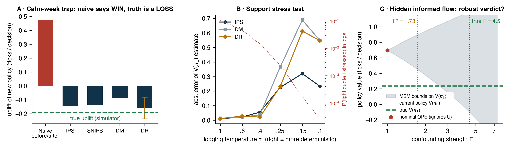

# MIRAGE: Did the New Quoting Strategy Make Money, or Did It Just Look Like It?

**Perceptron Hackathon 2026 (IITB × Optiver AI Innovation Lab) · Round 1 submission**
**Theme 2: Cause and Effect in AI Decisions · Problem 3**
**Team SoftMax (TM-916D5658C90):** Amit Singh Chauhan (leader), Anandita Thakur

📄 **[Read the abstract + architecture diagram (PDF)](MIRAGE_SoftMax_Round1.pdf)**

---

A market maker's quoting policy shapes the very PnL later used to judge it. Tight quotes win fills, including from informed traders who pick them off. So "PnL went up after we changed the strategy" usually measures the market regime, not the strategy.

MIRAGE answers *what would have happened under a different quoting policy* using only logged data from the current one:

1. **A simulator with known ground truth.** It has calm/stressed regimes, noise traders, and informed traders who hold a hidden signal *U*.
2. **An off-policy estimator bank.** IPS, SNIPS, Direct Method, cross-fitted Doubly Robust, Switch-DR and DRos, compared against naive before/after.
3. **An uncertainty layer that ends in a decision.** Day-block bootstrap CIs and a high-confidence lower bound give a **DEPLOY / DON'T DEPLOY** rule.
4. **A sensitivity layer for hidden confounding.** Marginal-sensitivity-model bounds and the breakdown Γ\*, *validated* against the true confounding strength, which only a simulator can provide.

## Prototype results (already working)



Across **10 independent simulated worlds**:

| Claim | Result |
|---|---|
| Naive before/after gets the sign of the uplift wrong | **10 / 10** |
| Doubly Robust gets the sign right | **10 / 10** |
| DR 95% CI contains the true uplift | **10 / 10** |
| Mean absolute error, naive vs DR (ticks / decision) | **0.63 vs 0.03** |
| With hidden confounding, nominal OPE wrongly says "deploy" | **10 / 10** |
| MSM bounds contain the truth at the true Γ | **10 / 10** |
| Breakdown Γ\* (verdict flagged as fragile) | **1.4 – 2.3** |

The prototype is intentionally small: 3 spread actions, one market order per decision, and no inventory carry-over. The full order-book simulator, 9 actions, the Open Bandit Dataset validation and the Policy Court dashboard are the Round 2 build.

## Run it

```bash
cd prototype
python -m venv .venv && source .venv/bin/activate
pip install -r requirements.txt
python mirage_proto.py      # ~4 min on a laptop CPU, writes results/results.json
python make_figures.py      # writes results/prototype_results.png
```

## Repository

```
MIRAGE_SoftMax_Round1.pdf   Round 1 abstract (pages 1–2) + architecture diagram (page 3)
abstract.html               Source of the PDF
prototype/
  mirage_proto.py           Simulator, policies, estimators, bootstrap, MSM bounds, experiments
  make_figures.py           Figure for the abstract
  requirements.txt
  results/                  results.json + prototype_results.png
```

## Key references
Saito et al., *Open Bandit Dataset and Pipeline* (NeurIPS D&B 2021) · Dudík et al., *Doubly Robust Policy Evaluation* (ICML 2011) · Su et al., *DR with Optimistic Shrinkage* (ICML 2020) · Thomas et al., *High-Confidence Off-Policy Evaluation* (AAAI 2015) · Kallus & Zhou, *Confounding-Robust Policy Improvement* (NeurIPS 2018) · Dorn & Guo, *Sharp Sensitivity Analysis for IPW* (JASA 2023) · Glosten & Milgrom (JFE 1985).
